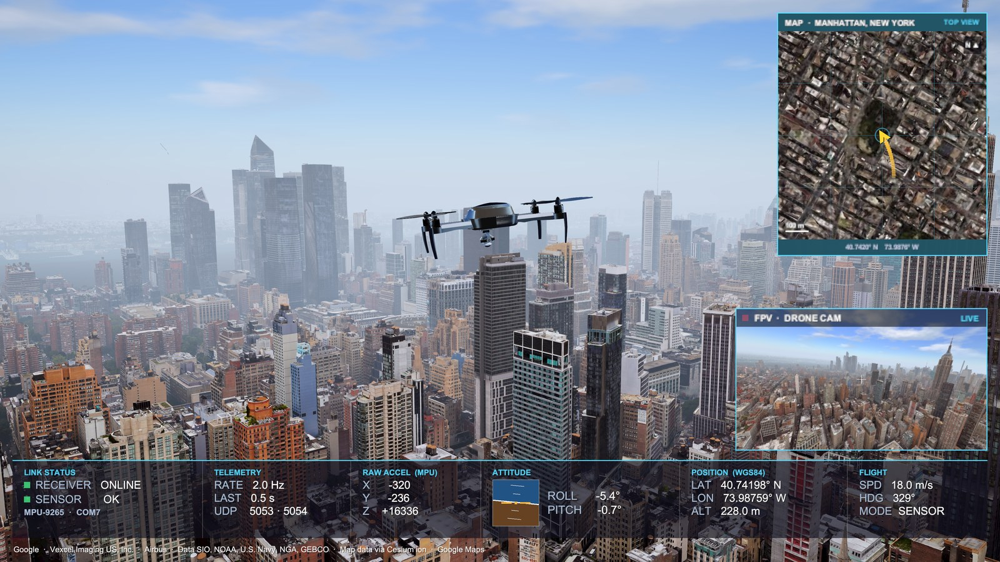
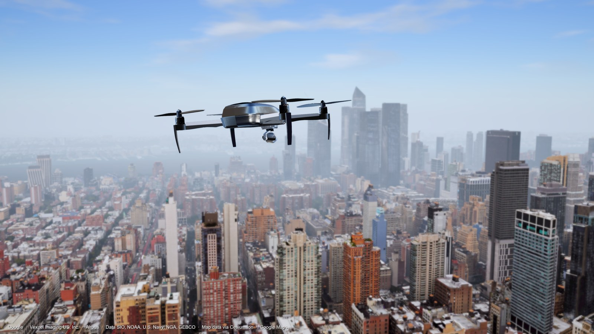

# Sensor Drone

아두이노 MPU 센서를 손으로 기울이면 Unity 속 드론이 같은 방향으로 기울고 선회하는 센서 연동 프로젝트입니다.
Cesium for Unity로 불러온 구글 실사 3D 지도(뉴욕 맨해튼) 위를 날고, 연결 상태·자세·위치를 관제 화면처럼 보여줍니다.



## 데모

| 관제 화면 (HUD · 미니맵 · FPV) | 맨해튼 상공을 나는 드론 |
| --- | --- |
|  |  |

시연 영상: [YouTube](https://youtu.be/2nedgZbypAI) · [포트폴리오 사이트](https://subinlu22.github.io/)의 Projects → Sensor Drone 카드

## 주요 기능

- **센서로 조종** — MPU 센서를 좌우로 기울이면 드론이 그 방향으로 기울며 선회하고, 앞뒤로 기울이면 상승·하강합니다.
- **부드러운 움직임** — 센서 값은 0.5초 간격으로 들어오지만, 드론은 목표 각도를 향해 부드럽게 따라갑니다.
- **실사 3D 지도** — Google Photorealistic 3D Tiles를 Cesium for Unity로 불러와 실제 위도·경도 위를 납니다.
- **관제 HUD** — 수신기·센서 연결 상태, 수신 속도(Hz), 센서 원값, 자세계(롤·피치), WGS84 좌표, 속도·방위를 표시합니다.
- **탑뷰 미니맵** — 드론 위에서 내려다본 지도에 비행 방향 화살표와 지나온 경로, 축척, 좌표를 표시합니다.
- **FPV 화면** — 드론에 달린 카메라 시점을 미니 화면으로 보여주며, 드론이 기울면 화면의 지평선도 같이 기웁니다.
- **연결 끊김 대응** — 센서 응답이 없으면 마지막 자세를 유지하고, USB가 순간적으로 끊겨도 수신기가 자동으로 다시 연결합니다.

## 동작 구조

```
MPU 센서 (I2C)
 │  가속도 X / Y / Z
 ▼
Arduino UNO (Arduino/mpu_sender)
 │  "X:ax Y:ay Z:az" 를 0.5초마다 시리얼로 출력 (115200 baud)
 ▼
Python (Sensor/mpu_receiver.py)
 │  COM 포트에서 한 줄씩 읽음, 응답 없음(X:-1) 값은 걸러냄
 ├─ UDP 127.0.0.1:5053 → 센서 값
 └─ UDP 127.0.0.1:5054 → 수신기·센서 상태 (OK / NOSENSOR / NODATA)
 ▼
Unity
    PlaneController.cs  : 센서 값 → 기울기·선회·상승/하강 → 드론 이동
    SensorHUD.cs        : 상태·원값·자세·좌표 표시
    DroneMinimap.cs     : 탑뷰 미니맵
    DroneFPV.cs         : 드론 카메라 시점
```

## 개발 환경

| 구분 | 내용 |
| --- | --- |
| Unity | 6000.3.11f1 (Unity 6.3 LTS) |
| 렌더 파이프라인 | URP 17.3.0 |
| 지도 | Cesium for Unity 1.26.0 + Google Photorealistic 3D Tiles |
| 카메라 | Cinemachine 3.1.7 |
| 모델 불러오기 | glTFast 6.20.0 |
| 하드웨어 | Arduino UNO + MPU-9265 (I2C: SDA → A4, SCL → A5) |
| 언어 | C#, Python 3.11 (`pyserial`), Arduino C++ |
| 통신 | 시리얼(115200) → UDP 5053 / 5054 |

## 실행 방법

1. **아두이노** — `Arduino/mpu_sender/mpu_sender.ino`를 UNO에 업로드합니다. (처음 한 번)
2. **Python 패키지** — 가상환경에 `pyserial`을 설치합니다. (처음 한 번)

   ```bash
   python -m venv venv
   venv\Scripts\python.exe -m pip install pyserial
   ```

3. **Cesium ion 로그인** — Unity에서 프로젝트를 열고 **Cesium → Cesium** 창에서 **Connect to Cesium ion**으로 로그인한 뒤, **Token**에서 토큰을 지정합니다. 토큰은 레포에 포함되지 않습니다.
4. **수신기 실행** — 아두이노 USB를 연결하고 `run_sensor.bat`을 실행합니다. 검은 창에 `X:… Y:… Z:…`가 올라오면 정상입니다. 포트가 다르면 `Sensor/mpu_receiver.py` 맨 위의 `PORT` 값을 바꿉니다.
5. **Unity 실행** — `Assets/Scenes/DroneCity.unity`를 열고 **Play**를 누른 뒤 센서를 기울여 조종합니다.

> **주의** — COM 포트는 한 프로그램만 쓸 수 있습니다. Arduino IDE의 시리얼 모니터가 켜져 있으면 수신기가 연결되지 않으니 닫고 실행합니다. 연결 상태는 하단 HUD의 `RECEIVER` / `SENSOR` 표시로 확인할 수 있습니다.

## 조작 설정 (DroneRig → PlaneController)

| 항목 | 기본값 | 설명 |
| --- | --- | --- |
| Speed | 18 | 전진 속도 (m/s) |
| Turn Rate | 1.2 | 좌우로 1° 기울일 때 초당 선회 각도 |
| Turn Deadzone | 3 | 이 각도 이하로 기울이면 직진 |
| Smooth Speed | 4 | 목표 기울기를 따라가는 속도 (클수록 빠르게 반응) |
| Invert Roll / Pitch | ✔ / ✘ | 좌우·앞뒤 기울기 방향 뒤집기 |
| Min / Max Altitude | 120 / 600 | 고도 제한 (m) |

## 프로젝트 구조

에셋스토어 팩(하늘·비행기 에셋 등)과 Cesium 토큰 파일은 레포에 포함하지 않습니다.

```
AirPlane/
├── run_sensor.bat                      # 수신기 실행
├── Arduino/mpu_sender/mpu_sender.ino   # MPU 센서 → 시리얼 출력
├── Sensor/mpu_receiver.py              # 시리얼 → UDP 전송 (Python)
├── Assets/
│   ├── Scenes/DroneCity.unity          # 메인 씬 (맨해튼)
│   ├── TENKOKU - DYNAMIC SKY/PlaneController.cs   # 센서 값 수신 및 드론 비행
│   ├── Scripts/
│   │   ├── SensorHUD.cs                # 하단 HUD
│   │   ├── DroneMinimap.cs             # 탑뷰 미니맵
│   │   └── DroneFPV.cs                 # 드론 카메라 미니 화면
│   ├── Settings/
│   │   ├── DistanceHaze.shader         # 거리 안개 + 구름 (풀스크린 셰이더)
│   │   ├── DroneCityPost.asset         # 후처리 (Bloom·DoF·Vignette·색보정)
│   │   └── URP_Pipeline.asset, URP_Renderer.asset
│   ├── Models/Drone/                   # 드론 모델 (glTF) + 호버 애니메이션
│   └── Editor/Screenshot4K.cs          # 4K 스크린샷 도구
└── docs/                               # README 이미지
```

| 파일 | 역할 |
| --- | --- |
| `mpu_sender.ino` | I2C로 MPU 센서의 가속도 X·Y·Z를 읽어 `X:ax Y:ay Z:az` 형식으로 0.5초마다 시리얼에 출력합니다. |
| `mpu_receiver.py` | 시리얼에서 한 줄씩 읽어 UDP 5053으로 Unity에 보냅니다. 응답 없음(`X:-1`) 값은 거르고, 상태를 UDP 5054로 따로 보내며, 포트가 끊기면 1초마다 다시 연결합니다. |
| `PlaneController.cs` | 별도 스레드에서 UDP 센서 값을 받습니다. 가속도를 기울기 각도로 바꿔 목표 자세로 부드럽게 따라가고, 좌우 기울기만큼 선회하며 기수 방향으로 이동합니다. |
| `SensorHUD.cs` | 상태 포트(5054)를 듣고 연결 상태·수신 Hz·센서 원값을 표시합니다. 드론의 롤·피치로 자세계를 그리고, Cesium으로 위도·경도·고도를 계산해 보여줍니다. |
| `DroneMinimap.cs` | 드론 위 직교 카메라로 탑뷰 지도를 렌더링합니다. 로딩 부담을 줄이려고 미니맵 전용 저해상도 지도를 `Minimap` 레이어로 따로 둡니다. |
| `DroneFPV.cs` | 드론 모델의 카메라 위치에서 앞을 보는 카메라를 만들어 미니 화면으로 보여줍니다. |
| `DistanceHaze.shader` | Unity 기본 포그가 적용되지 않는 Cesium 지도에도 거리 안개를 입히고, 하늘에 흐르는 구름과 지평선 블렌딩을 더합니다. |

## 에디터 도구

- **Tools > Screenshot 4K** (`Ctrl+Shift+K`) — Main Camera 화면을 3840×2160 PNG로 프로젝트의 `Screenshots/` 폴더에 저장합니다.

## 출처

- Drone model: ["Animated Drone"](https://sketchfab.com/3d-models/animated-drone-d47d61f8a78d4cce9f985ad7ade3e403) by [hartwelkisaka](https://sketchfab.com/hartwelkisaka), licensed under [CC BY 4.0](https://creativecommons.org/licenses/by/4.0/)
- Map data: Google Photorealistic 3D Tiles via [Cesium for Unity](https://cesium.com/platform/cesium-for-unity/) (화면 하단에 데이터 출처 표시)